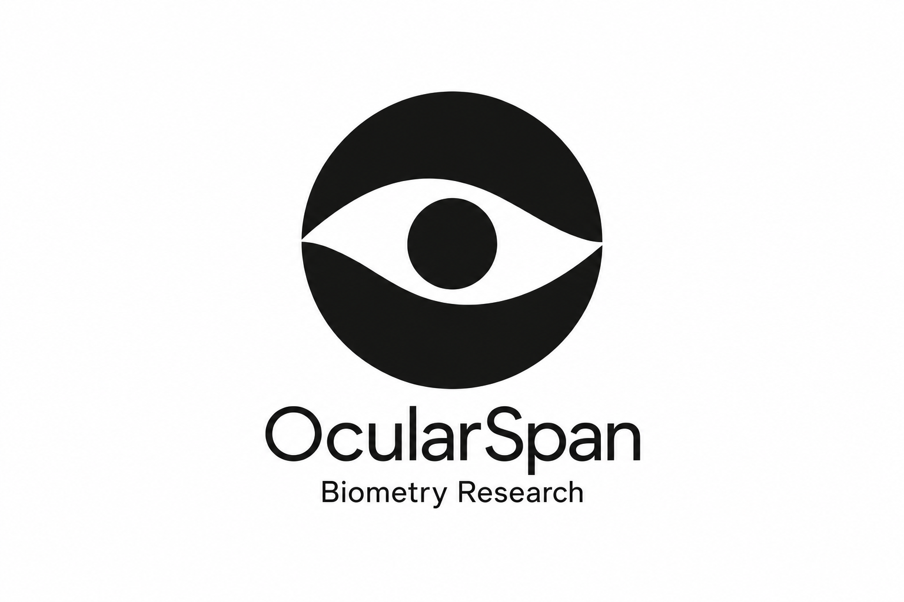

# OcularSpan

**Biometry Research · 独立眼部生物测量科研工具**



OcularSpan 是一个本地 Windows 研究工具：读取使用者导出的 ESX 扫描数据，自动估计豚鼠眼轴长度（AL）、角膜厚度（CCT）、前房房水深度（AD）、晶体厚度（LT）及探索性视网膜厚度（RT），直接导出简洁的 Excel。

**本项目非厂家官方软件，未由 Haag-Streit 设计、认证或背书。** LENSTAR LS 900 和 EyeSuite 名称仅用于说明当前支持的数据来源，不表示官方合作或授权。仅供科研，不用于临床诊断。软件按现状提供；完整使用范围和责任说明见 [项目说明](docs/PROJECT_NOTICE.md) 与 [MIT LICENSE](LICENSE)。

## 下载与使用

1. 到 [Releases](https://github.com/bzpb1998/OcularSpan/releases/latest) 下载 **OcularSpan-v0.3.0-windows-x64.zip**，不要下载 Source code 代替 Windows 包。
2. 完整解压，保留 `_internal` 和许可证目录。
3. 双击 **OcularSpan.exe**，直接打开独立窗口，无需安装 Python、Conda，不启动浏览器或本地 HTTP 服务。
4. 选择或拖入原始 ESX，点击“开始分析”，完成后点击“保存 Excel”。

没有 before/after 选项，文件默认按时间命名，可自行修改。详见[使用指南](docs/USER_GUIDE.md)。


## 文件与权限

- **输入只读**：读取用户选中的 ESX；选择文件夹时只读取当前层，不递归扫描。
- **独立输出**：只把 Excel 保存到使用者选择的位置，不修改原始 ESX。
- **不连接设备或数据库**：无需 EyeSuite/MySQL 账号、数据库 SELECT 权限或管理员权限。
- **本地处理**：默认桌面版不上传研究资料、不监听网络端口。主动点击 GitHub 链接才会打开在线文档。
- Windows 包未购买商业代码签名。请从本仓库下载并核对随包 SHA-256，依所在单位安全政策运行，不要关闭系统安全功能。

## Excel 输出

只有“测量数据”和“说明”两张表。一只动物一行，OD/OS 横向排列，中间留两列空白；指标顺序为 AL、CCT、AD、LT、RT。晶体边界不可靠时 AD/LT 留空，复核提示写在说明页。程序不做组间统计或造模效果分析。

## 研究范围与复现

软件 **v0.3.0** 使用原来锁定的 **V5** 模型，未因改名、界面或图标重新训练。它针对所述豚鼠数据开发，并不因为名称通用就支持其他设备或物种。现有 V5 评价为已揭盲历史数据上的回顾性评价，尚待新动物前瞻性验证。人工参考不是独立解剖学真值，质量标签不是准确概率。

- [模型、历史评价和限制](docs/MODEL_VALIDATION.md)
- [源码、Conda/venv、合成示例与构建](docs/REPRODUCIBILITY.md)
- [环境文件](environment.yml)；[固定 Windows 依赖](requirements-lock-windows-py312.txt)

```powershell
conda env create -f environment.yml
conda activate ls900-biometry-v5
python -m pip install -e . --no-deps --no-build-isolation
ocularspan-desktop
# 命令行批处理
ocularspan --input "D:\data\raw" --output "D:\results\measurements.xlsx"
```

原 `ls900_biometry` Python 导入名和 `ls900-biometry` / `ls900-desktop` 命令保留兼容；它们不是厂家组件。完整训练复现仍需私有训练信号与人工标签，仓库不含这些资料。

## 支持与引用

遇到问题请在 [Issues](https://github.com/bzpb1998/OcularSpan/issues) 提交软件版本、操作步骤和去除身份信息的错误描述。**不要上传患者资料、原始研究 ESX、人工参考表或厂家软件。** 可使用仓库的合成示例复现。社区支持按可用时间提供，不承诺服务时限。

引用：Zhang J. *OcularSpan*. v0.3.0. GitHub. 论文正式发表前不虚构 DOI；机器可读引用见 [CITATION.cff](CITATION.cff)。

[SpikeFinder](https://github.com/timothylcooke/SpikeFinder) 是另一个查看光学生物测量仪原始数据的独立研究项目。其数据库访问方式与本工具读取导出文件的方式不同；本项目不依赖或分发 SpikeFinder。相关工作不构成本工具获得厂家授权的证明。

## 许可与项目关系

项目代码采用 MIT；依赖库保留各自许可证，见 [第三方说明](THIRD_PARTY_NOTICES.md)。程序按现状提供，不保证结果准确性、适用性或不侵权；在适用法律允许范围内，责任限制以随附 LICENSE 为准。使用者应有权访问和使用输入数据，保存原始备份并复核研究结论。公开代码不授予第三方商标、专利或数据权利。

仓库不包含 EyeSuite 安装包、厂家 DLL/手册、原始 ESX、患者或动物记录。公开发行记录从 **v0.3.0** 起展示，后续版本按更新顺序保留。

## English

OcularSpan is independent ocular biometry research software, not designed or endorsed by Haag-Streit. It reads user-exported ESX files from LENSTAR LS 900 / EyeSuite and writes a separate two-sheet Excel workbook. It does not connect to the instrument or its database. The current model targets guinea-pig research and is not for clinical diagnosis. The software is provided as-is under the MIT License; third-party rights and licenses remain applicable.
